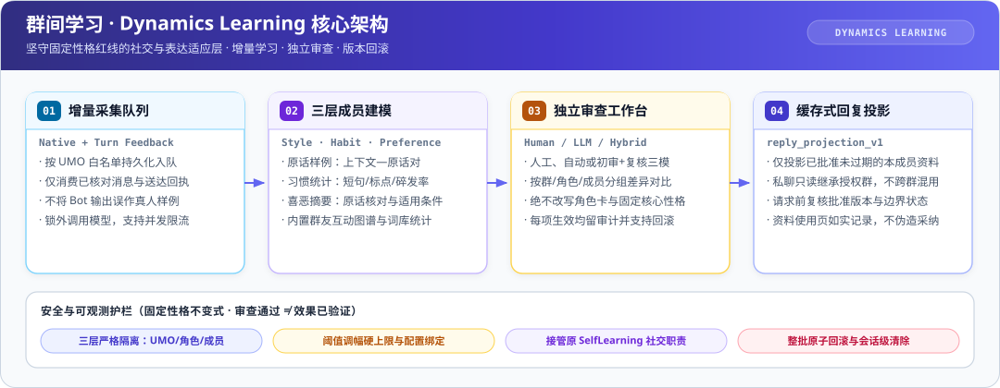

# 群间学习 · Dynamics Learning

**群间系列社交与表达适应层：严守固定性格红线，从真实互动中学习群友习惯、黑话与关系，经审查生效并支持回滚。**

[核心能力](#核心能力) · [系列联动](#与群间系列的联动) · [快速开始](#快速开始) · [群间系列生态](#群间系列生态) · [文档与许可](#进阶文档与许可)

---

## 核心能力

- **三层成员资料与固定性格边界**：在严格保留 Bot 自身角色卡与核心性格的前提下，按「完整会话 UMO + 角色 + 成员」隔离沉淀三类观察——**原话样例**（上下文—原话对）、**习惯统计**（短句/标点/碎发比例）与**喜恶摘要**（核对原话与适用条件）；可选开启接话场景学习与本群表达习惯候选。
- **增量队列与锁外调度**：通过持久化收件队列按回合边界增量处理真实消息与送达回执，绝不将 Bot 回复误作真人样例；短锁准备快照、锁外异步调用分析与审查模型，不阻塞群聊采集。
- **独立审查工作台与版本回滚**：按类别独立配置 `human`（人工审查）、`llm`（自动审查）或 `llm_then_human`（LLM 初审 + 人工确认，默认）模式。工作台支持按群/角色/成员分组对比前后差异、原子批量操作及逐版本审计回滚。
- **社交关系图谱与运行总览**：内置群友互动统计核心（活跃分布、常互动伙伴、互惠与语气证据），采用后台缓存快照驱动成员互动图谱、好感与黑话管理；资料使用页如实记录经边界过滤实际进入请求的资料 ID 与版本，不伪造采纳效果。

## 与群间系列的联动

- **群间 · Chat Dynamics**：通过 `social` 能力协议与缓存式 `reply_projection_v1` 提供已批准且未过期的成员适应线索与决策微调（接话阈值调幅受硬上限与配置摘要绑定）；本插件不直接发送群消息，完整接管原 SelfLearning 社交职责并保留 `query_affection` 只读工具。
- **群间记忆 & 群间世界**：通过共享引用核验过往证据，不把学习策略写入长期记忆，不干涉角色持续生活与情绪状态。私聊仅只读继承原授权群的本人资料，不跨群合并好感。

## 快速开始

1. 在 AstrBot（`>=4.29.4,<5`）安装本插件与配套 **群间 · Chat Dynamics**；若曾启用旧 SelfLearning，请先停用或暂停其冲突功能。
2. 在插件配置中填写完整 UMO 格式的「生效会话」（空列表不采集也不注入），分别选择普通聊天 LLM 作为「分析模型」与「审查模型」（不使用 Jev 抉择服务）。
3. 打开 **「群间学习」** Web 面板：在运行总览观察采集与队列状态，在审查工作台核对并批准/回滚提案，在成员资料与图谱页查看统计与资料使用记录。

---

## 群间系列生态

| 插件 | 仓库与标识 | 核心定位 |
| --- | --- | --- |
| **群间 · Chat Dynamics** | [`astrbot_plugin_chat_dynamics`](https://github.com/ysyhlly/astrbot_plugin_chat_dynamics) | 核心对话调度层：碎发聚合、话题路由、参与决策与节奏交付 |
| **群间世界 · Dynamics World** | [`astrbot_plugin_dynamics_world`](https://github.com/ysyhlly/astrbot_plugin_dynamics_world) | 角色卡、世界书、双地图天气、持续生活与 3D 实况小屋 |
| **群间记忆 · Dynamics Memory** | [`astrbot_plugin_dynamics_memory`](https://github.com/ysyhlly/astrbot_plugin_dynamics_memory) | 长期记忆、混合召回、2D/3D 图谱与原文证据冲突审查 |
| **群间学习 · Dynamics Learning**（当前） | [`astrbot_plugin_dynamics_learning`](https://github.com/ysyhlly/astrbot_plugin_dynamics_learning) | 固定性格红线下的成员资料、黑话好感与可回滚审查学习 |
| **群间见闻 · Dynamics Horizons** | [`astrbot_plugin_dynamics_horizons`](https://github.com/ysyhlly/astrbot_plugin_dynamics_horizons) | 角色隔离外部信息源与书架、自主精读与分群待讨论话题 |
| **群间游戏 · Dynamics Games** | [`astrbot_plugin_dynamics_games`](https://github.com/ysyhlly/astrbot_plugin_dynamics_games) | 共读/约局/接龙/挑战/共创协作与四大群聊娱乐引擎 |
| **群间史记 · Dynamics Chronicle** | [`astrbot_plugin_group_chronicle`](https://github.com/ysyhlly/astrbot_plugin_group_chronicle) | 原文依据的长期群史卷册、人物传记与群文化梗沿革 |
| **群间视觉 · Visual Media** | [`astrbot_plugin_visual_media`](https://github.com/ysyhlly/astrbot_plugin_visual_media) | 表情收集检索、多模态生图改图与角色视觉形象管理 |

---

## 进阶文档与许可

- [发布说明](RELEASE_NOTES.md) · [更新日志](CHANGELOG.md) · [接口契约](docs/contract.md)
- [三层成员资料](docs/three-layers.md) · [回复投影与适应](docs/reply-adaptation.md) · [社交图谱与迁移](docs/social-v2.md) · [场景与表达学习](docs/scene-learning-v014.md)
- 交流与反馈：项目反馈群兼聊天群 QQ `203363132`
- 群友关系核心归属见 `vendor/group_relations/NOTICE.md`；本项目基于 [MIT License](LICENSE) 开源。
